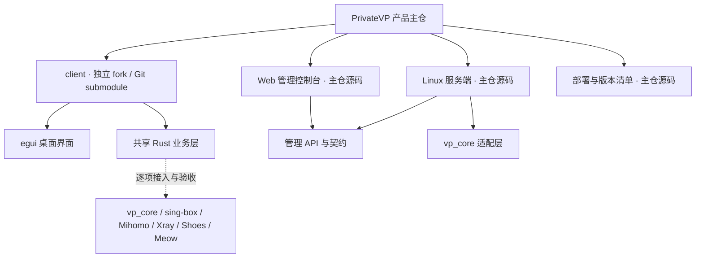

# PrivateVP

统一管理客户端、Linux 服务端、Web 控制台与部署工具。客户端基于 `vpn-parser` fork 演进，服务端优先使用 `vp_core`；组件可以独立开发，产品版本在这里统一锁定。

**当前阶段：工程整合中，尚无可直接安装的正式发行版。** 首个基础版本包含文档与真实客户端 submodule；服务端、管理 Web 和安装工具已在本地归集，正在发布前审查，尚未纳入这个基础版本。既有原型与测试结果不会自动视为新产品验收结果。

主仓：[vickkk-kkk/vp-product](https://github.com/vickkk-kkk/vp-product)（私有） · 客户端 fork：[vickkk-kkk/vpn-parser](https://github.com/vickkk-kkk/vpn-parser)（公开）。源码、发布与验证是不同状态，详见 [当前快照](docs/source-snapshot.md)。

[项目结构](docs/architecture.md) · [开发指南](docs/development.md) · [支持状态](docs/support.md) · [版本与发布](docs/releases.md) · [安全约定](SECURITY.md)

## 一个入口，两条开发线

图中虚线表示产品目标，不表示所有引擎或移动平台已经可用。Web 控制台是服务端管理界面，不是浏览器 VPN。

## 仓库怎么分

| 入口 | 负责什么 | 本轮落地状态 |
| --- | --- | --- |
| `client/` | 客户端 fork；桌面界面、共享业务层及未来移动端适配 | 已绑定上游基线提交，尚不含未提交的客户端改造 |
| `crates/`、`contracts/` | 服务端 Rust workspace 与共享管理契约 | 本地已归集，未纳入基础版本，待审查 |
| `flutter/apps/vp_admin/` | Web 管理端，保留所需 `flutter/packages/` | 本地已归集，未纳入基础版本；不含旧 Flutter 客户端 |
| `tools/install/` | 安装、打包、升级与运维工具 | 本地已归集，未纳入基础版本；无线上安装命令 |
| [docs/](docs/README.md) | 架构、开发、支持范围与发布规范 | 已建立 |

根目录不建立跨客户端与服务端的“大 Cargo workspace”。客户端保留自己的依赖锁；主仓通过 submodule 的精确提交绑定它。旧 Flutter 客户端保留在历史工程中，不作为第二套活跃客户端带入。

## 从哪里开始

1. 先看 [支持状态](docs/support.md)，区分已有源码、已有测试和待验收能力。
2. 按 [开发指南](docs/development.md) 克隆主仓并检查 submodule。
3. 修改客户端在 fork 中提交；修改服务端、Web 或部署工具在主仓提交。跨组件变更同时更新契约与版本清单。

当前不提供 `curl | sh`、自动下载内核或一键改系统代理的快速启动命令。构建入口将在新目录完成复核后补充，避免给出无法复现的操作。

## 质量与边界

- 不把配置解析、编译通过或版本探测写成“连接成功”。
- 每个引擎、平台分别记录真实流量、切换、停止、后台与故障恢复结果。
- 不静默切换引擎，不丢弃安全相关未知字段，不提交真实订阅、凭据或私钥。
- 发布必须绑定主仓提交、客户端提交、引擎身份、锁文件和可核验测试证据。

## 来源与许可

客户端来源于 [mateo-ki/vpn-parser](https://github.com/mateo-ki/vpn-parser)，基线提交为 `cf3bfcf8fc70518e75d036bd4db72fcee8713541`，其 MIT 许可与版权声明须保留。服务端核心来源于 [mateo-ki/vp_core](https://github.com/mateo-ki/vp_core)。主仓许可证与各引擎再分发条件仍需逐项确认；客户端 MIT 许可不覆盖整个产品。详见 [第三方来源](THIRD_PARTY_NOTICES.md)。
